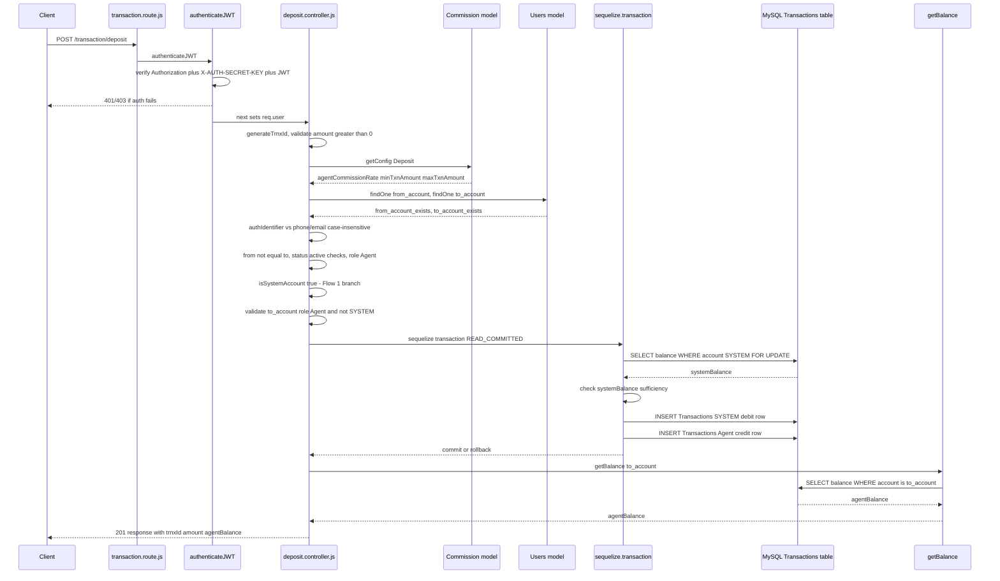
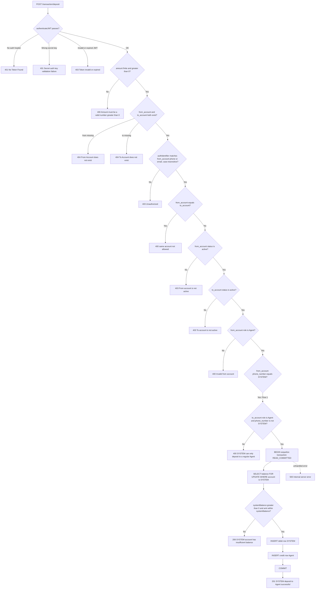
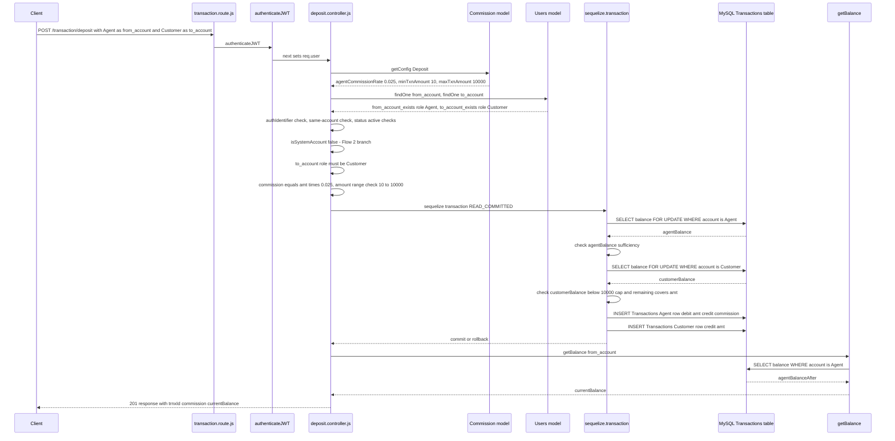
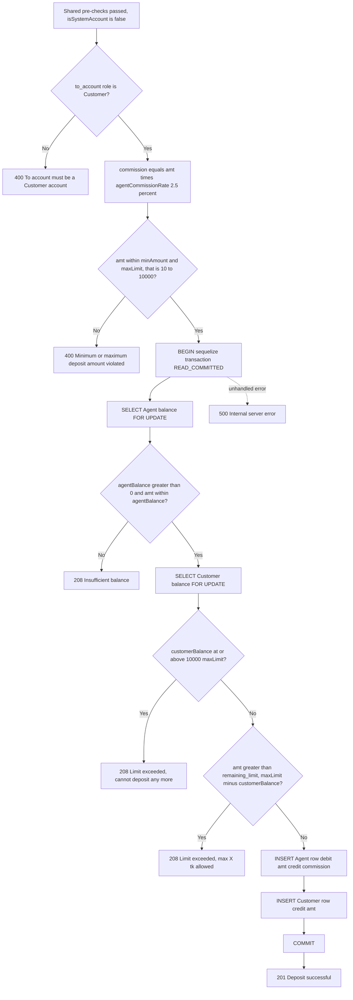
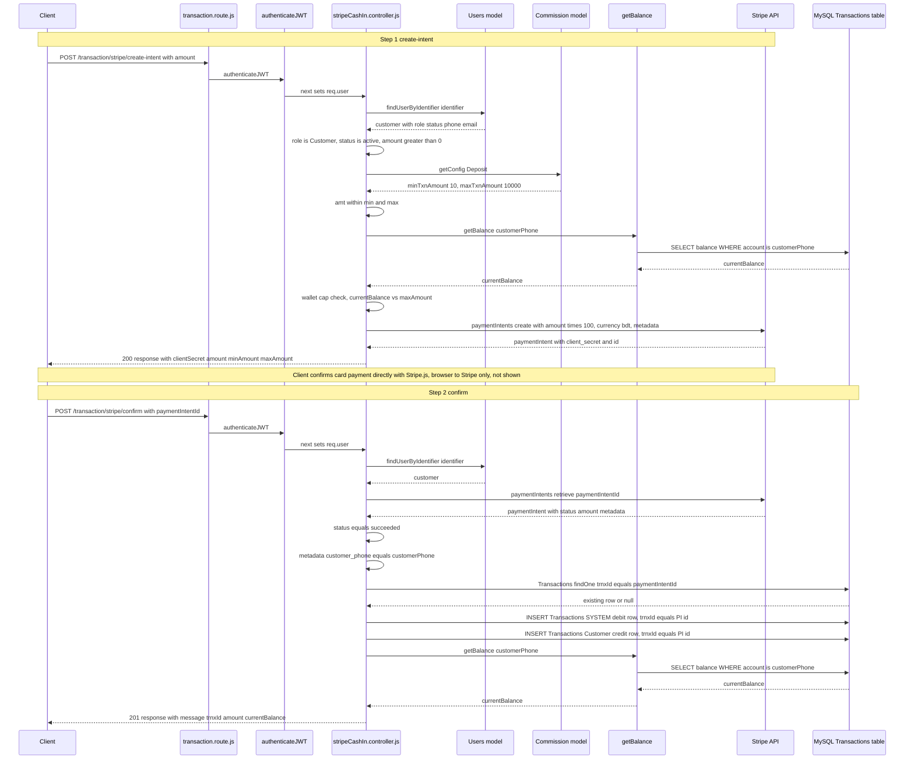

# Deposit (Cash-In) Feature — Deep-Dive Reverse Engineering

**Scope:** `dmoney-transaction-api` backend only.
**Repository root for this analysis:** `d:\RoadToSDET\dmoney\dmoney-transaction-api`
**Method:** Every claim below is backed by a direct code citation (`file:line`). Where behavior is derived from reading multiple files together rather than stated outright, it is marked **"Inferred from implementation."** Where something could not be found in the code, it is marked **"Not Implemented"**.

Flows covered:
1. Deposit Flow 1 — SYSTEM → Regular Agent top-up
2. Deposit Flow 2 — Regular Agent → Customer deposit
3. Stripe Bank Cash-In (Customer) — `create-intent` + `confirm`

---

## 1. Route & Middleware Wiring

| Endpoint | Method | Middleware | Controller function | Citation |
|---|---|---|---|---|
| `/transaction/deposit` | POST | `authenticateJWT` | `depositController.handleDeposit` | `routes/transaction.route.js:19` |
| `/transaction/stripe/create-intent` | POST | `authenticateJWT` | `stripeCashInController.createPaymentIntent` | `routes/transaction.route.js:24` |
| `/transaction/stripe/confirm` | POST | `authenticateJWT` | `stripeCashInController.confirmCashIn` | `routes/transaction.route.js:25` |

`authenticateJWT` (`jwtMiddleware.js:7-33`) requires **both**:
- `Authorization: Bearer <jwt>` header — missing -> `401 { message: 'No Token Found!' }` (`jwtMiddleware.js:31`).
- `X-AUTH-SECRET-KEY` header exactly equal to `process.env.PARTNER_KEY` — mismatch -> `401 { message: 'Secret auth key validation failure!' }` (`jwtMiddleware.js:27-29`).
- JWT verified with `ACCESS_TOKEN_SECRET`; on failure: expired -> `403 { message: 'Token expired!' }` (`jwtMiddleware.js:17-18`); any other verify error -> `403 { message: 'Token invalid!' }` (`jwtMiddleware.js:19-21`).
- On success, `req.user = { identifier, role }` (JWT payload) is attached (`jwtMiddleware.js:24`) and used by every controller below as `req.user.identifier`.

All three deposit-family endpoints use `authenticateJWT` (not the weaker `publicAuthenticateJWT`), so all three require the JWT + secret-key pair.

---

## 2. Flow 1 - SYSTEM to Regular Agent Top-Up

**Controller:** `controllers/transactions/deposit.controller.js`, function `handleDeposit` (`deposit.controller.js:24-281`).

### 2.1 Narrative - full call chain

1. **Route** `POST /transaction/deposit` -> `authenticateJWT` -> `depositController.handleDeposit` (`routes/transaction.route.js:19`).
2. Body destructured: `from_account`, `to_account`, `amount` (`deposit.controller.js:25`). `trnxId` is pre-generated immediately via `generateTrnxId()` (`deposit.controller.js:27`, `services/generateTrnxId.js:12-19`) - generated before any validation.
3. **Amount validation:** `amt = Number(amount)`; if not finite or `<= 0` -> `400 { message: Amount must be a valid number greater than 0 }` (`deposit.controller.js:26,29-31`).
4. **Commission config load:** `Commission.getConfig(Deposit)` (`deposit.controller.js:34`) queries `Commissions` where `transaction_type=Deposit AND is_active=true` (`sequelizeModel/Commission.js:70-73`). Seeded row (`migrations/create_commission_table.js:69`: Agent Commission, percentage, rate 0.025, min_txn_amount 10.00, max_txn_amount 10000.00) populates `config.agentCommissionRate = 0.025`, `config.minTxnAmount = 10`, `config.maxTxnAmount = 10000` (`Commission.js:86-101`). Controller fallback defaults: `commissionRate = config.agentCommissionRate || 0.025`, `minAmount = config.minTxnAmount || 10`, `maxLimit = config.maxTxnAmount || 10000` (`deposit.controller.js:35-37`).
5. **Account existence:** both `from_account` and `to_account` looked up via `Users.findOne` on `phone_number` (`deposit.controller.js:39-40`). Missing -> `404` with distinct messages (`deposit.controller.js:274-279`).
6. **Authorization (case-insensitive):** `authIdentifier = req.user.identifier`; compared against `from_account`'s stored phone_number and email, all lower-cased (`deposit.controller.js:47-52`). No match -> `403 Unauthorized: you can only initiate transactions from your own account` (`deposit.controller.js:52-56`). This is the only transaction controller among Deposit/Withdraw/SendMoney/Payment that does this comparison case-insensitively (`deposit.controller.js:44-51`); `withdraw.controller.js:34-36` uses strict `!==` (case-sensitive).
7. **Same-account guard:** `from_account === to_account` -> `400 From account and to account cannot be the same` (`deposit.controller.js:58-60`).
8. **Status checks:** `from_account.status !== active` -> `403 From account is not active` (`deposit.controller.js:63-65`); `to_account.status !== active` -> `403 To account is not active` (`deposit.controller.js:66-68`).
9. **Role gate on from_account:** `from_account.role !== Agent` -> `400 Invalid from account` (`deposit.controller.js:71-75`). The SYSTEM seed user is itself created with role Agent (`sequelizeModel/Users.js:75`), so this single check covers both flows.
10. **Flow discriminator:** `isSystemAccount = from_account.phone_number === SYSTEM` (`deposit.controller.js:78`). If true -> Flow 1 branch (`deposit.controller.js:85-156`).
11. **Flow 1 to_account validation:** `to_account.role !== Agent` OR `to_account.phone_number === SYSTEM` -> `400 SYSTEM account can only deposit to a regular Agent account` (`deposit.controller.js:87-92`). Rejects Customer, Merchant, Admin, and SYSTEM-to-itself.
12. **No commission, no min/max amount check in Flow 1** - the minAmount/maxLimit computed at step 4 are never referenced inside the Flow-1 branch (Inferred from implementation: comparing lines 85-156 against Flow 2's lines 172-177, 208-217).
13. **Atomic block** - sequelize.transaction with isolationLevel READ_COMMITTED (`deposit.controller.js:98-138`):
    - Locking read: SELECT SUM(credit)-SUM(debit) FROM Transactions WHERE account = ? FOR UPDATE bound to from_account (SYSTEM) (`deposit.controller.js:102-105`).
    - Sufficiency check: systemBalance <= 0 OR amt > systemBalance -> throws INSUFFICIENT_BALANCE with .balance (`deposit.controller.js:108-112`), caught outside as `208 SYSTEM account has insufficient balance` (`deposit.controller.js:148-152`).
    - Ledger write 1 (SYSTEM debit): account=from_account, description=System Deposit to Agent, debit=amt, credit=0, transaction_type=Deposit (`deposit.controller.js:115-124`).
    - Ledger write 2 (Agent credit): account=to_account, description=Top-up from SYSTEM, debit=0, credit=amt, transaction_type=Deposit (`deposit.controller.js:127-136`).
14. **Success response:** `201 SYSTEM deposit to Agent successful` with trnxId, amount, agentBalance from getBalance(to_account) (`deposit.controller.js:140-145`).
15. **Any other error** -> logged via console.error and `500 Internal server error` (`deposit.controller.js:154-155`).

### 2.2 Sequence Diagram - Flow 1

### 2.3 Flowchart - Flow 1 decision branches

---

## 3. Flow 2 - Regular Agent to Customer Deposit

**Controller:** same file, `else` branch of `handleDeposit` (`deposit.controller.js:161-272`), reached when `isSystemAccount` is false (`deposit.controller.js:78,85,161`).

### 3.1 Narrative - full call chain

Steps 1-9 are identical to Flow 1 (same file, same function, shared pre-checks) - see section 2.1 items 1-9. From there:

1. **Flow discriminator:** `isSystemAccount` is false (from_account is a non-SYSTEM Agent) - enters else branch (`deposit.controller.js:161`).
2. **to_account role validation:** `toRole !== Customer` -> `400 To account must be a Customer account. A regular Agent can only deposit to a Customer.` (`deposit.controller.js:164-168`).
3. **Commission pre-computation:** `commission = commissionRate * amt` (2.5 percent of amount, from `Commission.getConfig(Deposit)` loaded earlier) (`deposit.controller.js:170`).
4. **Amount range check:** `amt < minAmount OR amt > maxLimit` (10 through 10000, from the seeded Deposit row's min_txn_amount/max_txn_amount) -> `400 Minimum deposit amount is 10 tk and maximum deposit amount is 10000 tk` (`deposit.controller.js:173-177`).
5. **Atomic block** - sequelize.transaction with isolationLevel READ_COMMITTED (`deposit.controller.js:185-243`):
   - Locking read on Agent: SELECT SUM(credit)-SUM(debit) FROM Transactions WHERE account = ? FOR UPDATE bound to from_account (`deposit.controller.js:189-192`).
   - Agent sufficiency check: agentBalance <= 0 OR amt > agentBalance -> throws INSUFFICIENT_BALANCE with .balance (`deposit.controller.js:195-199`) - caught as `208 Insufficient balance` with currentBalance equal to err.balance (`deposit.controller.js:253-257`).
   - Locking read on Customer (to_account), same query pattern (`deposit.controller.js:202-205`).
   - Wallet-cap check number 1 (already at cap): customerBalance >= maxLimit (10000) -> throws CUSTOMER_CAP_EXCEEDED (`deposit.controller.js:208-210`) -> `208 Limit exceeded. You cannot deposit any more to this account.` (`deposit.controller.js:259-263`).
   - Wallet-cap check number 2 (would exceed cap): remaining_limit = maxLimit minus customerBalance; amt > remaining_limit -> throws AMOUNT_EXCEEDS_REMAINING_LIMIT with .remaining (`deposit.controller.js:212-217`) -> `208 Limit exceeded. You can deposit a maximum of X.XX tk to this customer.` (`deposit.controller.js:264-268`).
   - Ledger write 1 (Agent debit plus commission credit combined in one row): account equals from_account, description equals Deposit Commission, debit equals amt, credit equals commission, transaction_type equals Deposit (`deposit.controller.js:219-228,240`). This single row carries both a debit and a credit for the Agent's own account - Agent net balance impact for this operation equals credit minus debit equals commission minus amt (Inferred from implementation, since balance equals SUM(credit) minus SUM(debit) per `services/getBalance.js:8`).
   - Ledger write 2 (Customer credit): account equals to_account, description equals Deposit, debit equals 0, credit equals amt, transaction_type equals Deposit (`deposit.controller.js:229-238,241`).
6. **Success response:** `201 Deposit successful` with trnxId, commission, currentBalance equal to getBalance(from_account) (`deposit.controller.js:245-250`) - note currentBalance here is the Agent's balance, not the customer's.
7. **Any other error** -> `500 Internal server error` (`deposit.controller.js:269-270`).

### 3.2 Sequence Diagram - Flow 2

### 3.3 Flowchart - Flow 2 decision branches

---

## 4. Stripe Bank Cash-In Flow (Customer)

**Controller:** `controllers/transactions/stripeCashIn.controller.js` - two exported functions, `createPaymentIntent` (`stripeCashIn.controller.js:30-113`) and `confirmCashIn` (`stripeCashIn.controller.js:125-210`).

### 4.1 Narrative - POST /transaction/stripe/create-intent

1. **Route:** `POST /transaction/stripe/create-intent` -> `authenticateJWT` -> `createPaymentIntent` (`routes/transaction.route.js:24`).
2. **Find customer by JWT identifier:** `findUserByIdentifier(identifier)` looks up Users where email equals identifier OR phone_number equals identifier (`stripeCashIn.controller.js:11-21,33-36`). Missing -> `404 Customer account not found` (`stripeCashIn.controller.js:37-39`). Unlike the Deposit controller, this lookup uses Sequelize Op.or on both fields directly with the raw identifier value - no toLowerCase normalization on either side (`stripeCashIn.controller.js:12-19`), so matching relies on Sequelize/MySQL default (collation-dependent) string comparison rather than an explicit case-insensitive JS compare like Deposit Flow 1 uses.
3. **Role and status gate:** role not equal to Customer -> `403 Only customers can use bank cash-in` (`stripeCashIn.controller.js:44-46`); status not equal to active -> `403 Your account is not active. Please contact admin.` (`stripeCashIn.controller.js:47-49`).
4. **Amount validation:** amt equals Number(amount); falsy, NaN, or at most 0 -> `400 Amount must be a positive number` (`stripeCashIn.controller.js:52-55`).
5. **Commission config:** `Commission.getConfig(Deposit)` reused (same seeded row as the agent-deposit flow) giving minAmount equal to config.minTxnAmount or 10, maxAmount equal to config.maxTxnAmount or 10000 (`stripeCashIn.controller.js:58-60`).
6. **Amount range check:** amt below minAmount -> `400 Minimum cash-in amount is 10 tk` (`stripeCashIn.controller.js:62-64`); amt above maxAmount -> `400 Maximum cash-in amount is 10000 tk` (`stripeCashIn.controller.js:65-67`).
7. **Wallet-cap check:** currentBalance equals await getBalance(customerPhone) (`stripeCashIn.controller.js:71`, `services/getBalance.js:7-9`). If currentBalance at or above maxAmount -> `208 Limit exceeded. Your wallet is already at maximum capacity.` (`stripeCashIn.controller.js:73-77`). Else remaining equals maxAmount minus currentBalance; amt above remaining -> `208 Limit exceeded. You can cash in a maximum of X.XX tk.` (`stripeCashIn.controller.js:78-85`).
8. **Stripe PaymentIntent creation:** stripe.paymentIntents.create with amount equal to Math.round(amt times 100), currency bdt, metadata containing customer_phone, customer_email, dmoney_amount (`stripeCashIn.controller.js:89-97`) - no DB write yet.
9. **Success response:** `200` with clientSecret, amount, minAmount, maxAmount (`stripeCashIn.controller.js:99-104`).
10. **Any exception** (including Stripe API errors) -> `500 Failed to create payment intent` (`stripeCashIn.controller.js:106-112`).

### 4.2 Narrative - POST /transaction/stripe/confirm

1. **Route:** `POST /transaction/stripe/confirm` -> `authenticateJWT` -> `confirmCashIn` (`routes/transaction.route.js:25`).
2. **Input check:** paymentIntentId required in body - missing -> `400 paymentIntentId is required` (`stripeCashIn.controller.js:129-131`).
3. **Find customer** via the same findUserByIdentifier helper - missing -> `404 Customer account not found` (`stripeCashIn.controller.js:136-139`). No role or status re-check here - confirmCashIn does not re-verify role equals Customer or status equals active the way createPaymentIntent does (Inferred from implementation: compare lines 30-113 vs 125-210, the active/role gate only exists in the create-intent handler).
4. **Retrieve PI from Stripe:** stripe.paymentIntents.retrieve(paymentIntentId) (`stripeCashIn.controller.js:144`). If status not equal to succeeded -> `400 Payment not completed, Stripe status: X` (`stripeCashIn.controller.js:146-150`).
5. **Anti-spoofing check:** paymentIntent.metadata.customer_phone not equal to customerPhone (of the currently authenticated caller) -> `403 Payment intent does not belong to this account` (`stripeCashIn.controller.js:153-157`).
6. **Idempotency guard:** Transactions.findOne where trnxId equals paymentIntentId (`stripeCashIn.controller.js:160-162`) - if a row already exists with this trnxId (this PI was already confirmed) -> `208 This payment has already been processed` (`stripeCashIn.controller.js:163-165`).
7. **Amount derivation:** amt equals paymentIntent.amount divided by 100 (Stripe stores paisa/poisha, converted back to taka) (`stripeCashIn.controller.js:168`). trnxId equals paymentIntentId - the Stripe PI id itself is reused as the ledger trnxId for traceability (`stripeCashIn.controller.js:169`).
8. **Ledger writes are NOT wrapped in a sequelize.transaction()** (Inferred from implementation: no sequelize.transaction call anywhere in confirmCashIn, unlike both Deposit flows and other transaction controllers which use sequelize.transaction with isolationLevel plus row-level FOR UPDATE locking):
   - Write 1 (SYSTEM debit): account equals SYSTEM, from_account equals STRIPE, to_account equals customerPhone, description equals Bank Cash In (Stripe), debit equals amt, credit equals 0 - transaction_type is not set (defaults to NULL per model default, `sequelizeModel/Transactions.js:35-40`) (`stripeCashIn.controller.js:173-181`).
   - Write 2 (Customer credit): account equals customerPhone, from_account equals STRIPE, to_account equals customerPhone, description equals Bank Cash In (Stripe), debit equals 0, credit equals amt - also no transaction_type (`stripeCashIn.controller.js:184-192`).
   - No SELECT FOR UPDATE balance lock is taken before these writes - there is no balance-sufficiency check needed here (SYSTEM debit is unconditional, funded by the external Stripe charge), but it also means these two Transactions.create calls are two independent statements rather than one atomic unit (Inferred from implementation).
9. **Success response:** `201 Cash in successful` with trnxId, amount, currentBalance equal to getBalance(customerPhone) (`stripeCashIn.controller.js:194-201`).
10. **Any exception** -> `500 Failed to process cash in` (`stripeCashIn.controller.js:203-209`).

### 4.3 Sequence Diagram - Stripe Cash-In (both steps)

### 4.4 Flowchart - Stripe Cash-In decision branches

```mermaid
flowchart TD
    subgraph CreateIntent[POST /transaction/stripe/create-intent]
    A[Request] --> B{Customer found by identifier?}
    B -- No --> B1[404 Customer account not found]
    B -- Yes --> C{role is Customer?}
    C -- No --> C1[403 Only customers can use bank cash-in]
    C -- Yes --> D{status is active?}
    D -- No --> D1[403 Your account is not active]
    D -- Yes --> E{amount valid and greater than 0?}
    E -- No --> E1[400 Amount must be a positive number]
    E -- Yes --> F{amt within min and max, 10 to 10000?}
    F -- No --> F1[400 Minimum or maximum cash-in amount violated]
    F -- Yes --> G{currentBalance at or above maxAmount?}
    G -- Yes --> G1[208 Wallet already at maximum capacity]
    G -- No --> H{amt greater than remaining, maxAmount minus currentBalance?}
    H -- Yes --> H1[208 Limit exceeded, max X tk]
    H -- No --> I[Stripe paymentIntents create]
    I --> J[200 clientSecret returned]
    I -.error.-> K1[500 Failed to create payment intent]
    end

    subgraph Confirm[POST /transaction/stripe/confirm]
    L[Request with paymentIntentId] --> M{paymentIntentId present?}
    M -- No --> M1[400 paymentIntentId is required]
    M -- Yes --> N{Customer found by identifier?}
    N -- No --> N1[404 Customer account not found]
    N -- Yes --> O[Stripe paymentIntents retrieve]
    O --> P{status equals succeeded?}
    P -- No --> P1[400 Payment not completed, status X]
    P -- Yes --> Q{metadata customer_phone equals customerPhone?}
    Q -- No --> Q1[403 Payment intent does not belong to this account]
    Q -- Yes --> R{Transactions row with trnxId equal to PI id already exists?}
    R -- Yes --> R1[208 This payment has already been processed]
    R -- No --> S[INSERT SYSTEM debit row]
    S --> T[INSERT Customer credit row]
    T --> U[201 Cash in successful]
    O -.error or exception.-> V1[500 Failed to process cash in]
    end
```

---

## 5. Commission, Limits and Ledger Summary Table

| Aspect | Flow 1: SYSTEM to Agent | Flow 2: Agent to Customer | Stripe Cash-In (Customer) |
|---|---|---|---|
| Config source | `Commission.getConfig(Deposit)` loaded but not applied in this branch (`deposit.controller.js:34-37,85-156`) | `Commission.getConfig(Deposit)` (`deposit.controller.js:34`) | `Commission.getConfig(Deposit)` (`stripeCashIn.controller.js:58`) |
| Commission or fee applied | None | commission equals amt times 0.025 (Agent Commission, percentage, seeded rate 0.025) (`deposit.controller.js:170`; `migrations/create_commission_table.js:69`) | None - no fee/commission row of any recipient type is applied to a Stripe cash-in |
| Who pays / who receives commission | n/a | Platform-sourced credit to the Agent, same ledger row as their debit (`deposit.controller.js:219-228`) | n/a |
| min_fee floor used? | n/a, no fee | Not applicable - Deposit's Agent Commission row has min_fee NULL (`migrations/create_commission_table.js:69`); `Commission.calcFee()` is not even called in Flow 2, commission is computed inline as commissionRate times amt (`deposit.controller.js:170`), not via `Commission.calcFee(rule, amount)` | n/a |
| max_fee used? | Not Implemented, column exists on Commissions schema but never read anywhere (`Commission.js` has no reference to max_fee) | Same, Not Implemented | Same, Not Implemented |
| Per-transaction min/max amount | Not enforced (Inferred: minAmount and maxLimit computed but unused in Flow 1 branch) | Enforced, amt must be in the range 10 to 10000 (`deposit.controller.js:173-177`) | Enforced, amt must be in the range 10 to 10000 (`stripeCashIn.controller.js:62-67`) |
| checkCustomerLimits (daily/monthly outgoing limit) applied? | No, from_account is SYSTEM (Agent role), not Customer, and Deposit is not an outgoing type | No, checkCustomerLimits is never imported or called in `deposit.controller.js` (confirmed by inspection of imports); scope is `services/limitChecker.js:21` OUTGOING_TYPES equal to SendMoney, Payment, Withdraw only, Deposit is not included | No, `stripeCashIn.controller.js` never imports limitChecker; same scoping reason, Deposit/cash-in is an incoming transaction, not in OUTGOING_TYPES |
| 10000 BDT wallet cap | Not enforced (Customer is not the to_account in this flow) | Enforced via two checks inside the locked transaction: customerBalance at or above maxLimit yields 208; else amt greater than remaining (maxLimit minus customerBalance) yields 208 (`deposit.controller.js:208-217`) | Enforced via the same pattern but outside any DB transaction or lock, using a plain unlocked getBalance read: currentBalance at or above maxAmount yields 208; else amt greater than remaining yields 208 (`stripeCashIn.controller.js:73-85`) |
| DB transaction and locking | `sequelize.transaction` with isolationLevel READ_COMMITTED, SELECT FOR UPDATE on SYSTEM's balance (`deposit.controller.js:98-105`) | `sequelize.transaction` with isolationLevel READ_COMMITTED, SELECT FOR UPDATE on both Agent's and Customer's balance (`deposit.controller.js:185-205`) | None, no sequelize.transaction wrapper and no FOR UPDATE lock around the two Transactions.create calls (`stripeCashIn.controller.js:173-192`) |
| trnxId source | `generateTrnxId()`, TXN plus 10 random uppercase alphanumeric characters (`services/generateTrnxId.js:12-19`; `deposit.controller.js:27`) | Same `generateTrnxId()` (`deposit.controller.js:27`) | Stripe's own paymentIntentId, reused verbatim as trnxId (`stripeCashIn.controller.js:169`), doubles as the idempotency key |
| Ledger rows written | 2 rows, both transaction_type Deposit: row 1 account is from_account SYSTEM, debit equals amt, credit equals 0, description System Deposit to Agent; row 2 account is to_account Agent, debit equals 0, credit equals amt, description Top-up from SYSTEM (`deposit.controller.js:115-136`) | 2 rows, both transaction_type Deposit: row 1 account is from_account Agent, debit equals amt, credit equals commission, description Deposit Commission; row 2 account is to_account Customer, debit equals 0, credit equals amt, description Deposit (`deposit.controller.js:219-241`) | 2 rows, transaction_type left NULL (never set): row 1 account SYSTEM, from_account STRIPE, to_account customerPhone, debit equals amt, credit equals 0, description Bank Cash In (Stripe); row 2 account customerPhone, from_account STRIPE, to_account customerPhone, debit equals 0, credit equals amt, description Bank Cash In (Stripe) (`stripeCashIn.controller.js:173-192`) |
| Success HTTP status | 201 (`deposit.controller.js:140`) | 201 (`deposit.controller.js:245`) | 201 for confirm, 200 for create-intent since no ledger write happens yet (`stripeCashIn.controller.js:99,196`) |
| getBalance usage | Called once post-commit for to_account, Agent, giving agentBalance in the response (`deposit.controller.js:144`) | Called once post-commit for from_account, Agent, giving currentBalance in the response (`deposit.controller.js:249`) | Called once in create-intent for the wallet-cap check (`stripeCashIn.controller.js:71`), and once in confirm post-write for the response (`stripeCashIn.controller.js:194`) |

---

## 6. Gaps and Hidden Rules (Inferred from implementation)

These are behaviors visible only by reading multiple parts of the code together; none are stated as explicit requirements anywhere in the repository. Presented as reverse-engineered observations, not defects.

1. **Flow 1 bypasses the amount range check entirely.** Commission.getConfig(Deposit) is loaded once at the top of handleDeposit and its minAmount and maxLimit values are computed (deposit.controller.js:34-37), but the Flow-1 branch (deposit.controller.js:85-156, SYSTEM to Agent) never references minAmount or maxLimit - only Flow 2 does (deposit.controller.js:173-177). A SYSTEM to Agent top-up of any positive amount, bounded only by SYSTEM actual balance, is possible, unlike the 10 to 10000 BDT band enforced for Agent to Customer and Stripe cash-in.

2. **Commission.calcFee() is defined but not called anywhere in the deposit flows.** sequelizeModel/Commission.js:113-120 defines calcFee(rule, amount) (used by Withdraw/SendMoney/Payment per CLAUDE.md section 8), but deposit.controller.js computes commission inline as commissionRate times amt (deposit.controller.js:170) rather than iterating config.rules and calling calcFee. Since the seeded Deposit rule has no min_fee (migrations/create_commission_table.js:69), the practical result is identical, but the code path is structurally different from Withdraw/SendMoney/Payment (Inferred from implementation).

3. **max_fee on the Commissions schema is dead configuration for every transaction type**, deposit included - Commission.js never reads rule.max_fee in calcFee() (Commission.js:113-120) or anywhere else in the file.

4. **Case-sensitivity inconsistency in the from-account authorization check.** deposit.controller.js:47-52 lower-cases both the JWT identifier and the stored phone_number/email before comparing with equality after toLowerCase, while withdraw.controller.js:34-36 compares with strict inequality, no case normalization. A caller whose stored phone_number or email differs only in case from the login identifier would be authorized on Deposit but rejected as unauthorized on Withdraw (matches CLAUDE.md section 16 stated inconsistency; confirmed directly here by reading both files relevant lines side by side).

5. **checkCustomerLimits() (daily/monthly outgoing-limit system) never applies to any deposit-family endpoint.** Confirmed: neither deposit.controller.js nor stripeCashIn.controller.js imports services/limitChecker.js. The function own scope is hard-coded to OUTGOING_TYPES equal to SendMoney, Payment, Withdraw (services/limitChecker.js:21) and it is invoked with a sender phone number and a debit total (services/limitChecker.js:82-86,102) - a design that only makes sense for money leaving a Customer account. Deposit/cash-in is a credit-to-Customer operation, so it falls outside this system by construction, not by omission.

6. **The 10000 BDT wallet cap and the daily/monthly outgoing limits are two independent systems**, confirmed here specifically for deposits: the wallet cap (maxTxnAmount from the Deposit Commission row) gates how much a Customer can receive or hold (deposit.controller.js:208-217; stripeCashIn.controller.js:73-85), while TransactionLimits (sequelizeModel/TransactionLimit.js, seeded migrations/create_transaction_limits.js:59-60: Customer daily 5000 tk over 10 transactions, monthly 50000 tk over 50 transactions) gates outgoing spend and is structurally unreachable from either deposit path.

7. **Stripe confirmCashIn performs no re-validation of the customer role or status** between create-intent and confirm - only createPaymentIntent checks role equals Customer and status equals active (stripeCashIn.controller.js:44-49). If an account is suspended between the two calls, confirmCashIn would still process the ledger write (Inferred from implementation: no such check exists in confirmCashIn, stripeCashIn.controller.js:125-210).

8. **Stripe ledger writes are not wrapped in a sequelize.transaction() or row lock**, unlike both Deposit flows (which use READ_COMMITTED plus SELECT FOR UPDATE) and the other transaction controllers referenced in CLAUDE.md section 7. The two Transactions.create calls in confirmCashIn (stripeCashIn.controller.js:173-192) are independent statements; a crash between them would leave a single unmatched debit or credit row. This is mitigated in practice by the idempotency check, trnxId equals paymentIntentId, checked before either write (stripeCashIn.controller.js:160-165), but a partial-write scenario is not itself guarded against by any DB transaction boundary.

9. **transaction_type is left NULL for Stripe cash-in ledger rows**, despite the Transactions model own column comment listing StripeCashIn as an expected value (sequelizeModel/Transactions.js:35-39) - stripeCashIn.controller.js:173-192 never sets transaction_type in either Transactions.create call.

10. **findUserByIdentifier() in the Stripe controller does not normalize case**, unlike Deposit explicit toLowerCase comparison (deposit.controller.js:47-51). It relies on Sequelize Op.or directly against email and phone_number (stripeCashIn.controller.js:11-21), so its case sensitivity is governed by the MySQL column collation rather than application code - a different mechanism from either Deposit or Withdraw comparison style (Inferred from implementation; MySQL default collations are frequently case-insensitive for utf8mb4_general_ci or utf8mb4_unicode_ci, but this was not independently verified against the actual configured collation in this analysis).

11. **Flow 2 single Agent ledger row mixes a debit and a credit in one row** (debit equals amt, credit equals commission on the same Transactions row, deposit.controller.js:219-228), whereas Flow 1 and the Stripe flow each write a pure-debit row and a pure-credit row separately. This is a structural difference in the double-entry bookkeeping pattern used, though it still nets out correctly against SUM(credit) minus SUM(debit) in getBalance.

12. **getBalance() underlying SQL is built by string concatenation** of the account parameter (services/getBalance.js:8), not parameterized - this applies identically to every wallet-cap/balance read used across all three flows documented here (deposit.controller.js:144,249; stripeCashIn.controller.js:71,194), and to the FOR UPDATE locking queries in the Deposit flows, which by contrast do use bound replacements with question-mark placeholders (deposit.controller.js:102-105,189-192,202-205). This SQL-construction inconsistency exists specifically between services/getBalance.js and the raw queries embedded directly in deposit.controller.js.

13. **trnxId is generated before any validation runs** in handleDeposit (deposit.controller.js:27, executed before the amount check at line 29) - an unused, never-persisted ID is generated on every rejected request. No functional effect since it is discarded if the request fails, but it is a measurable extra crypto.randomBytes call per invalid request (Inferred from implementation).

---

## 7. Files Read for This Analysis

- dmoney-transaction-api/controllers/transactions/deposit.controller.js
- dmoney-transaction-api/controllers/transactions/stripeCashIn.controller.js
- dmoney-transaction-api/controllers/transactions/withdraw.controller.js (comparison only, lines 34-36)
- dmoney-transaction-api/services/limitChecker.js
- dmoney-transaction-api/services/getBalance.js
- dmoney-transaction-api/services/generateTrnxId.js
- dmoney-transaction-api/sequelizeModel/Commission.js
- dmoney-transaction-api/sequelizeModel/Transactions.js
- dmoney-transaction-api/sequelizeModel/Users.js
- dmoney-transaction-api/sequelizeModel/TransactionLimit.js
- dmoney-transaction-api/routes/transaction.route.js
- dmoney-transaction-api/jwtMiddleware.js
- dmoney-transaction-api/migrations/create_commission_table.js
- dmoney-transaction-api/migrations/create_transaction_limits.js
